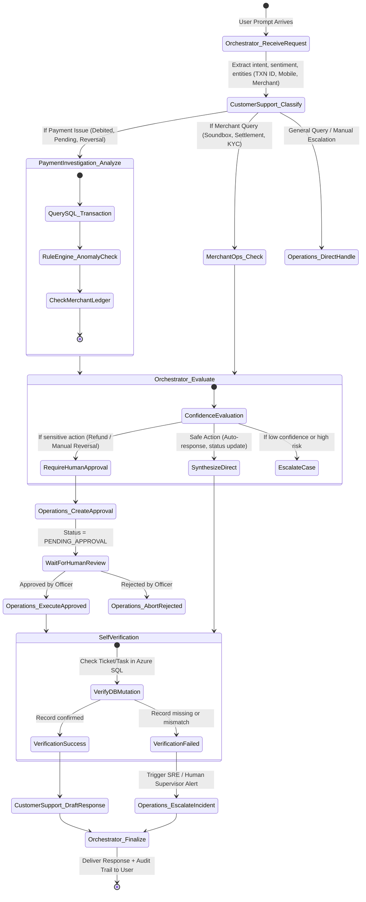

# Paytm ResolveAI - Agent Orchestration & State Graph Design

This document details the multi-agent orchestration architecture implemented using the official **Microsoft Agent Framework (`microsoft/agent-framework`)**.

---

## 1. Multi-Agent Topology & State Graph



---

## 2. Agent Roles and Tool Responsibilities

| Agent Name | Core Mandate | Deterministic Tools | Safety Boundaries |
|------------|--------------|-------------------|-------------------|
| **Central Orchestrator** | Task planning, entity extraction, graph execution, recovery, final verification | `plan_execution_graph()`, `dispatch_handoff()`, `verify_result()` | Max 8 iterations, 45s hard timeout |
| **Customer Support Agent** | Sentiment analysis, urgency rating, ticket creation, customer response generation | `get_customer()`, `search_customer_by_mobile()`, `get_customer_history()`, `create_ticket()`, `update_ticket()`, `draft_customer_response()` | No database deletes. Cannot mark tickets resolved without verified outcome |
| **Payment Investigation Agent** | SQL transaction lookup, bank gateway code inspection, deterministic anomaly rules | `get_transaction()`, `search_transactions()`, `get_payment_history()`, `get_merchant_payment_status()`, `analyze_payment_status()` | **STRICT READ-ONLY ON FINANCIAL LEDGERS**. Zero refund or reversal API permissions |
| **Merchant Operations Agent** | Merchant profiles, Soundbox status, EDC machines, onboarding verification | `get_merchant()`, `search_merchant()`, `get_merchant_onboarding_status()`, `get_missing_documents()`, `get_merchant_transactions()`, `create_merchant_followup()` | Cannot alter merchant bank accounts directly |
| **Operations Agent** | Case prioritization, employee assignment, SLA calculation, Human-in-the-loop approvals | `assign_ticket()`, `escalate_ticket()`, `request_approval()`, `get_approval_status()`, `create_followup()`, `verify_task()` | Every sensitive action triggers an immutable approval row in Azure SQL |

---

## 3. Shared Context Schema (State Dictionary)

The execution graph maintains a typed execution context passed across agent handoffs:

```python
class AgentExecutionContext(BaseModel):
    session_id: str
    task_id: str
    correlation_id: str
    user_query: str
    language: str = "en"  # "en", "hi", "te"
    customer_id: Optional[str] = None
    merchant_id: Optional[str] = None
    transaction_id: Optional[str] = None
    ticket_id: Optional[str] = None
    sentiment: str = "NEUTRAL"
    urgency: str = "MEDIUM"
    intent: str = "UNKNOWN"
    investigation_findings: Dict[str, Any] = Field(default_factory=dict)
    anomaly_detected: bool = False
    approval_required: bool = False
    approval_id: Optional[str] = None
    approval_status: Optional[str] = None
    step_history: List[Dict[str, Any]] = Field(default_factory=list)
    iteration_count: int = 0
    verification_passed: bool = False
    final_response: Optional[str] = None
```

---

## 4. Deterministic Payment Anomaly Rules

To avoid hallucinated judgments, payment investigation runs through deterministic rule checks:
1. **Rule 1 (Bank Delay - U69/RB01)**: If transaction status is `PENDING` and elapsed time $< 24$ hours, classify as `BANK_RECON_PENDING`. Auto-advise customer of the standard 24-48 hour NPCI settlement window; schedule automatic followup.
2. **Rule 2 (Double Debit)**: If two transactions exist for identical customer, merchant, and amount within a 5-minute window, classify as `DUPLICATE_DEBIT`. Flag for human approval refund on the duplicate record.
3. **Rule 3 (Merchant Not Received - Successful Debit)**: If transaction is `SUCCESS` on gateway but `PENDING_SETTLEMENT` on merchant terminal, inspect settlement cycle (T+1 vs instant). Advise merchant soundbox sync command.
