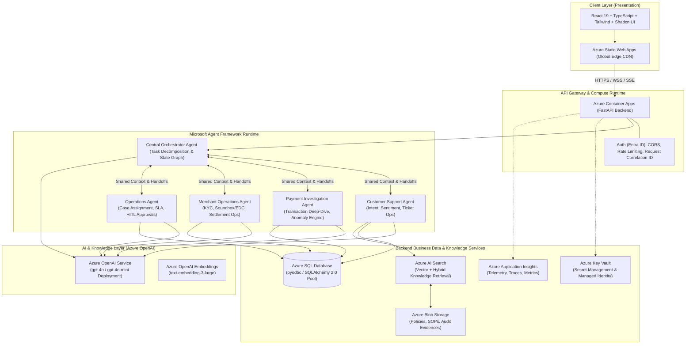

# Paytm ResolveAI - Technical Architecture Blueprint

## 1. Executive Summary & System Vision
Paytm ResolveAI is an enterprise-grade autonomous multi-agent workforce designed specifically for payment operations, merchant support, and customer care. Unlike naive chatbot wrappers, ResolveAI operates as an orchestrated, bounded, stateful workforce. It comprehends multi-turn customer and merchant queries, retrieves transactions and accounts from Azure SQL, consults policy knowledge in Azure AI Search, plans multi-step interventions, enforces human-in-the-loop (HITL) authorization for sensitive operations, self-verifies every state change, and produces tamper-evident audit trails.

---

## 2. End-to-End System Architecture

---

## 3. Core Architectural Principles
1. **Azure-First & Zero Public Provider Leakage**: Azure OpenAI is the exclusive LLM engine (`gpt-4o` for complex reasoning and planning; `gpt-4o-mini` for intent classification and entity extraction). No third-party LLMs (Anthropic, Gemini, OpenAI public) are permitted.
2. **Deterministic Financial Safety Boundary**: No LLM agent is ever granted direct execution capability for monetary refunds, chargebacks, reversals, or account debit/credit. High-impact operations emit a `PendingApproval` event requiring authenticated human authorization in Azure SQL.
3. **Bounded Graph Execution**: All multi-agent workflows are executed with strict iteration caps ($N \le 8$), token quotas, and hard timeouts ($T \le 45\text{s}$) to avoid infinite conversational looping or runaway cloud compute charges.
4. **Self-Verification Engine**: Every state mutation (e.g., ticket creation, escalation tag, merchant flag) must be actively verified by a post-execution check against Azure SQL before the orchestrator declares task completion.
5. **Least Privilege Data Isolation**: Cross-customer and cross-merchant memory leakage is prevented at the session level. Execution state is scoped by `session_id`, `customer_id`, and `merchant_id`.

---

## 4. Component Interactions & Communication Protocols
- **Client to Backend**: RESTful JSON APIs for synchronous data access; Server-Sent Events (SSE) for real-time agent execution streaming (steps, tool calls, thinking updates, verification outcomes).
- **Backend to Azure Services**:
  - **Azure SQL**: Managed Identity or encrypted ODBC connection string via `pyodbc` with connection pooling, retries with exponential backoff (`tenacity`), and read-committed snapshot isolation.
  - **Azure OpenAI**: Function calling via Azure OpenAI REST API v2024-06-01 / Python SDK with managed identity or API key stored in Key Vault.
  - **Azure AI Search**: Semantic search over vectorized compliance, refund SOPs, and UPI error code taxonomies.
  - **Application Insights**: OpenTelemetry distributed tracing tracing user request ID $\to$ orchestrator plan $\to$ tool invocations $\to$ database queries.
