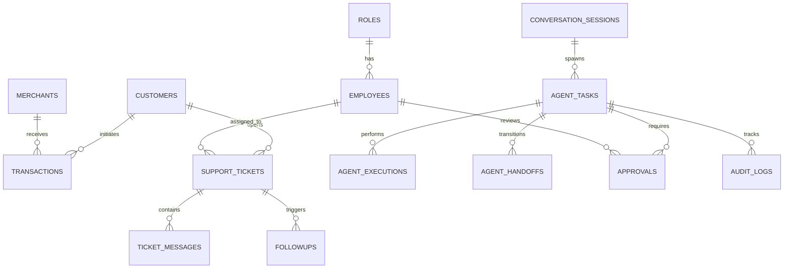

# Paytm ResolveAI - Database Schema Specification (Azure SQL Database)

This document specifies the 16 normalized relational tables required by Paytm ResolveAI, complete with DDL constraints, primary/foreign keys, indexes, and synthetic demo structures.

---

## 1. Schema Entity Relationship Diagram



---

## 2. Table Specifications & DDL Definitions

### Table 1: `roles`
```sql
CREATE TABLE roles (
    role_id NVARCHAR(50) PRIMARY KEY,
    name NVARCHAR(100) NOT NULL UNIQUE,
    description NVARCHAR(255),
    permissions NVARCHAR(MAX) NOT NULL, -- JSON array of granted permission scopes
    created_at DATETIMEOFFSET DEFAULT SYSDATETIMEOFFSET()
);
```

### Table 2: `employees`
```sql
CREATE TABLE employees (
    employee_id NVARCHAR(50) PRIMARY KEY,
    name NVARCHAR(150) NOT NULL,
    email NVARCHAR(150) NOT NULL UNIQUE,
    role_id NVARCHAR(50) NOT NULL FOREIGN KEY REFERENCES roles(role_id),
    department NVARCHAR(100) NOT NULL, -- 'CustomerSupport', 'PaymentOps', 'MerchantOps', 'Risk'
    status NVARCHAR(50) DEFAULT 'ACTIVE',
    created_at DATETIMEOFFSET DEFAULT SYSDATETIMEOFFSET(),
    updated_at DATETIMEOFFSET DEFAULT SYSDATETIMEOFFSET()
);
```

### Table 3: `customers`
```sql
CREATE TABLE customers (
    customer_id NVARCHAR(50) PRIMARY KEY,
    name NVARCHAR(150) NOT NULL,
    mobile NVARCHAR(20) NOT NULL UNIQUE,
    email NVARCHAR(150),
    kyc_status NVARCHAR(50) NOT NULL DEFAULT 'VERIFIED', -- 'PENDING', 'VERIFIED', 'SUSPENDED'
    account_status NVARCHAR(50) NOT NULL DEFAULT 'ACTIVE',
    vpa_address NVARCHAR(100), -- UPI ID, e.g. 'rahul@paytm'
    tier NVARCHAR(50) DEFAULT 'STANDARD', -- 'STANDARD', 'GOLD', 'PLATINUM'
    created_at DATETIMEOFFSET DEFAULT SYSDATETIMEOFFSET(),
    updated_at DATETIMEOFFSET DEFAULT SYSDATETIMEOFFSET()
);
CREATE INDEX ix_customers_mobile ON customers(mobile);
```

### Table 4: `merchants`
```sql
CREATE TABLE merchants (
    merchant_id NVARCHAR(50) PRIMARY KEY,
    business_name NVARCHAR(200) NOT NULL,
    category NVARCHAR(100) NOT NULL, -- 'Retail', 'Dining', 'Grocery', 'Fuel'
    mobile NVARCHAR(20) NOT NULL,
    email NVARCHAR(150),
    onboarding_status NVARCHAR(50) NOT NULL DEFAULT 'COMPLETED', -- 'INCOMPLETE', 'UNDER_REVIEW', 'COMPLETED'
    settlement_cycle NVARCHAR(50) DEFAULT 'T+1',
    soundbox_device_id NVARCHAR(100),
    edc_pos_id NVARCHAR(100),
    missing_docs NVARCHAR(MAX), -- JSON array of missing documents
    opportunity_flag NVARCHAR(100), -- 'SOUNDBOX_UPGRADE', 'LOAN_ELIGIBLE'
    created_at DATETIMEOFFSET DEFAULT SYSDATETIMEOFFSET(),
    updated_at DATETIMEOFFSET DEFAULT SYSDATETIMEOFFSET()
);
CREATE INDEX ix_merchants_business_name ON merchants(business_name);
```

### Table 5: `transactions`
```sql
CREATE TABLE transactions (
    transaction_id NVARCHAR(100) PRIMARY KEY,
    customer_id NVARCHAR(50) NOT NULL FOREIGN KEY REFERENCES customers(customer_id),
    merchant_id NVARCHAR(50) NOT NULL FOREIGN KEY REFERENCES merchants(merchant_id),
    amount DECIMAL(18, 2) NOT NULL,
    currency NVARCHAR(10) DEFAULT 'INR',
    status NVARCHAR(50) NOT NULL, -- 'SUCCESS', 'PENDING', 'FAILED', 'REVERSED'
    payment_method NVARCHAR(50) NOT NULL, -- 'UPI', 'WALLET', 'CARD', 'NETBANKING'
    bank_ref_no NVARCHAR(100), -- RRN (Retrieval Reference Number)
    gateway_response_code NVARCHAR(50), -- 'U00' (Success), 'U69' (Deemed Failure), 'RB01' (Bank Down)
    failure_reason NVARCHAR(255),
    created_at DATETIMEOFFSET DEFAULT SYSDATETIMEOFFSET(),
    updated_at DATETIMEOFFSET DEFAULT SYSDATETIMEOFFSET()
);
CREATE INDEX ix_transactions_cust_created ON transactions(customer_id, created_at DESC);
CREATE INDEX ix_transactions_merchant_created ON transactions(merchant_id, created_at DESC);
CREATE INDEX ix_transactions_bank_ref ON transactions(bank_ref_no);
```

### Table 6: `support_tickets`
```sql
CREATE TABLE support_tickets (
    ticket_id NVARCHAR(50) PRIMARY KEY,
    customer_id NVARCHAR(50) NOT NULL FOREIGN KEY REFERENCES customers(customer_id),
    transaction_id NVARCHAR(100) FOREIGN KEY REFERENCES transactions(transaction_id),
    category NVARCHAR(100) NOT NULL, -- 'PAYMENT_PENDING', 'FAILED_DEBITED', 'MERCHANT_NOT_RECEIVED'
    priority NVARCHAR(50) NOT NULL DEFAULT 'MEDIUM', -- 'LOW', 'MEDIUM', 'HIGH', 'CRITICAL'
    status NVARCHAR(50) NOT NULL DEFAULT 'OPEN', -- 'OPEN', 'IN_INVESTIGATION', 'PENDING_APPROVAL', 'RESOLVED', 'ESCALATED'
    assigned_employee_id NVARCHAR(50) FOREIGN KEY REFERENCES employees(employee_id),
    sla_deadline DATETIMEOFFSET NOT NULL,
    resolution_summary NVARCHAR(MAX),
    created_at DATETIMEOFFSET DEFAULT SYSDATETIMEOFFSET(),
    updated_at DATETIMEOFFSET DEFAULT SYSDATETIMEOFFSET()
);
CREATE INDEX ix_tickets_status_priority ON support_tickets(status, priority);
```

### Table 7: `ticket_messages`
```sql
CREATE TABLE ticket_messages (
    message_id NVARCHAR(50) PRIMARY KEY,
    ticket_id NVARCHAR(50) NOT NULL FOREIGN KEY REFERENCES support_tickets(ticket_id),
    sender_type NVARCHAR(50) NOT NULL, -- 'CUSTOMER', 'AGENT', 'HUMAN_SUPPORT', 'SYSTEM'
    sender_id NVARCHAR(50) NOT NULL,
    content NVARCHAR(MAX) NOT NULL,
    sentiment NVARCHAR(50), -- 'POSITIVE', 'NEUTRAL', 'NEGATIVE', 'VERY_ANGRY'
    language NVARCHAR(10) DEFAULT 'en', -- 'en', 'hi', 'te'
    created_at DATETIMEOFFSET DEFAULT SYSDATETIMEOFFSET()
);
CREATE INDEX ix_ticket_messages_ticket ON ticket_messages(ticket_id, created_at ASC);
```

### Table 8: `conversation_sessions`
```sql
CREATE TABLE conversation_sessions (
    session_id NVARCHAR(50) PRIMARY KEY,
    user_identifier NVARCHAR(100) NOT NULL,
    channel NVARCHAR(50) DEFAULT 'PORTAL', -- 'PORTAL', 'WHATSAPP', 'APP'
    session_metadata NVARCHAR(MAX), -- JSON bag for multi-turn conversational context
    created_at DATETIMEOFFSET DEFAULT SYSDATETIMEOFFSET(),
    last_activity_at DATETIMEOFFSET DEFAULT SYSDATETIMEOFFSET()
);
```

### Table 9: `agent_tasks`
```sql
CREATE TABLE agent_tasks (
    task_id NVARCHAR(50) PRIMARY KEY,
    session_id NVARCHAR(50) NOT NULL FOREIGN KEY REFERENCES conversation_sessions(session_id),
    description NVARCHAR(500) NOT NULL,
    intent NVARCHAR(100) NOT NULL,
    status NVARCHAR(50) NOT NULL DEFAULT 'PLANNED', -- 'PLANNED', 'RUNNING', 'COMPLETED', 'FAILED', 'AWAITING_APPROVAL'
    assigned_agent NVARCHAR(50) NOT NULL, -- 'Orchestrator', 'CustomerSupport', 'PaymentInvestigation', 'MerchantOps', 'Operations'
    plan_steps NVARCHAR(MAX), -- JSON representation of execution graph
    confidence_score DECIMAL(5, 4), -- 0.0000 to 1.0000
    verification_status NVARCHAR(50) DEFAULT 'UNVERIFIED', -- 'VERIFIED', 'FAILED_VERIFICATION'
    error_message NVARCHAR(MAX),
    started_at DATETIMEOFFSET,
    completed_at DATETIMEOFFSET,
    created_at DATETIMEOFFSET DEFAULT SYSDATETIMEOFFSET()
);
```

### Table 10: `agent_executions`
```sql
CREATE TABLE agent_executions (
    execution_id NVARCHAR(50) PRIMARY KEY,
    task_id NVARCHAR(50) NOT NULL FOREIGN KEY REFERENCES agent_tasks(task_id),
    agent_name NVARCHAR(100) NOT NULL,
    action_type NVARCHAR(100) NOT NULL, -- 'TOOL_CALL', 'REASONING_STEP', 'VERIFICATION'
    tool_name NVARCHAR(100),
    tool_input NVARCHAR(MAX), -- JSON string
    tool_output NVARCHAR(MAX), -- JSON string
    duration_ms INT NOT NULL,
    status NVARCHAR(50) NOT NULL, -- 'SUCCESS', 'FAILED', 'TIMED_OUT'
    created_at DATETIMEOFFSET DEFAULT SYSDATETIMEOFFSET()
);
CREATE INDEX ix_agent_executions_task ON agent_executions(task_id);
```

### Table 11: `agent_handoffs`
```sql
CREATE TABLE agent_handoffs (
    handoff_id NVARCHAR(50) PRIMARY KEY,
    task_id NVARCHAR(50) NOT NULL FOREIGN KEY REFERENCES agent_tasks(task_id),
    from_agent NVARCHAR(50) NOT NULL,
    to_agent NVARCHAR(50) NOT NULL,
    reason NVARCHAR(255) NOT NULL,
    context_payload NVARCHAR(MAX), -- JSON context passed to recipient agent
    created_at DATETIMEOFFSET DEFAULT SYSDATETIMEOFFSET()
);
```

### Table 12: `approvals`
```sql
CREATE TABLE approvals (
    approval_id NVARCHAR(50) PRIMARY KEY,
    task_id NVARCHAR(50) NOT NULL FOREIGN KEY REFERENCES agent_tasks(task_id),
    action_type NVARCHAR(100) NOT NULL, -- 'TRIGGER_REFUND', 'REVERSE_DEBIT', 'MERCHANT_OVERRIDE', 'CREDIT_ADJUSTMENT'
    entity_id NVARCHAR(100) NOT NULL, -- Target transaction_id or merchant_id
    risk_level NVARCHAR(50) NOT NULL, -- 'LOW', 'MEDIUM', 'HIGH', 'CRITICAL'
    requesting_agent NVARCHAR(50) NOT NULL,
    supporting_evidence NVARCHAR(MAX) NOT NULL,
    status NVARCHAR(50) NOT NULL DEFAULT 'PENDING', -- 'PENDING', 'APPROVED', 'REJECTED'
    reviewed_by NVARCHAR(50) FOREIGN KEY REFERENCES employees(employee_id),
    review_comments NVARCHAR(MAX),
    reviewed_at DATETIMEOFFSET,
    created_at DATETIMEOFFSET DEFAULT SYSDATETIMEOFFSET()
);
CREATE INDEX ix_approvals_status_risk ON approvals(status, risk_level);
```

### Table 13: `followups`
```sql
CREATE TABLE followups (
    followup_id NVARCHAR(50) PRIMARY KEY,
    ticket_id NVARCHAR(50) NOT NULL FOREIGN KEY REFERENCES support_tickets(ticket_id),
    trigger_reason NVARCHAR(255) NOT NULL, -- 'BANK_U69_RECONCILIATION', 'MERCHANT_KYC_DOC_PENDING'
    due_at DATETIMEOFFSET NOT NULL,
    status NVARCHAR(50) DEFAULT 'SCHEDULED', -- 'SCHEDULED', 'EXECUTED', 'CANCELLED'
    created_at DATETIMEOFFSET DEFAULT SYSDATETIMEOFFSET()
);
```

### Table 14: `knowledge_documents`
```sql
CREATE TABLE knowledge_documents (
    doc_id NVARCHAR(50) PRIMARY KEY,
    title NVARCHAR(255) NOT NULL,
    category NVARCHAR(100) NOT NULL, -- 'UPI_GUIDELINES', 'REFUND_POLICY', 'SOUNDBOX_TROUBLESHOOTING'
    blob_url NVARCHAR(500) NOT NULL,
    content_hash NVARCHAR(100) NOT NULL,
    indexed_in_search BIT DEFAULT 0,
    created_at DATETIMEOFFSET DEFAULT SYSDATETIMEOFFSET()
);
```

### Table 15: `audit_logs`
```sql
CREATE TABLE audit_logs (
    log_id NVARCHAR(50) PRIMARY KEY,
    correlation_id NVARCHAR(100) NOT NULL,
    actor_type NVARCHAR(50) NOT NULL, -- 'USER', 'AGENT', 'SYSTEM'
    actor_id NVARCHAR(100) NOT NULL,
    action NVARCHAR(100) NOT NULL,
    resource_type NVARCHAR(100) NOT NULL,
    resource_id NVARCHAR(100) NOT NULL,
    before_state NVARCHAR(MAX),
    after_state NVARCHAR(MAX),
    ip_address NVARCHAR(50),
    timestamp DATETIMEOFFSET DEFAULT SYSDATETIMEOFFSET()
);
CREATE INDEX ix_audit_logs_correlation ON audit_logs(correlation_id);
```

### Table 16: `agent_metrics`
```sql
CREATE TABLE agent_metrics (
    metric_id NVARCHAR(50) PRIMARY KEY,
    agent_name NVARCHAR(100) NOT NULL,
    total_invocations INT DEFAULT 0,
    successful_invocations INT DEFAULT 0,
    failed_invocations INT DEFAULT 0,
    avg_duration_ms INT DEFAULT 0,
    total_tokens_consumed INT DEFAULT 0,
    last_invoked_at DATETIMEOFFSET DEFAULT SYSDATETIMEOFFSET()
);
```
