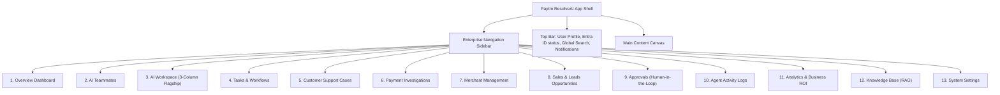

# Paytm ResolveAI - Frontend Architecture & Component Specification

This document details the frontend implementation plan using **React 19, TypeScript, Vite, Tailwind CSS, Shadcn/UI, Lucide React, and Recharts**.

---

## 1. Visual Identity & Design System
- **Primary Brand Colors**:
  - Paytm Deep Navy: `#002970` (Headers, active states, key accents)
  - Paytm Cyan/Electric Blue: `#00BAF2` (Call-to-actions, progress rings, links)
  - Background Neutral: `#F5F7FA` (Clean enterprise dashboard background)
  - Card Neutral: `#FFFFFF` (High contrast, subtle 1px border `#E2E8F0`)
- **Typography**: Inter / Outfit for high legibility in financial operational screens.
- **Component Palette**: Customized Shadcn/UI (Button, Dialog, Badge, Sheet, Tabs, Table, Tooltip, DropdownMenu, Alert, ScrollArea).

---

## 2. Navigation & Page Structure (13 Views)



---

## 3. Flagship AI Workspace Layout (3-Column Enterprise Studio)

The AI Workspace is the central operations hub where operators watch the AI workforce plan, execute, and verify tasks:

```
+---------------------+-------------------------------+--------------------------------+
| Column 1: AI Agents | Column 2: Conversational Hub  | Column 3: Real-Time Telemetry  |
| (Left - 260px)      | (Center - Flexible)           | (Right - 380px)                |
+---------------------+-------------------------------+--------------------------------+
| - Orchestrator      | - Omnichannel Chat Input      | - Live Execution Plan Steps    |
|   [Status: ACTIVE]  | - Multilingual Prompts        | - Handoff Flow Diagram         |
| - Support Agent     |   (English, Hindi, Telugu)    | - Backend Tool Invocations     |
|   [Status: IDLE]    | - Agent Message Stream        | - Retrieved SQL Records        |
| - Payment Agent     | - Pending Approval Banner     | - Anomaly Rule Verdict         |
|   [Status: RUNNING] |   [Approve] / [Reject]        | - Verification Status Check    |
| - Merchant Agent    | - Self-Verification Stamp     | - Token / Latency Counter      |
| - Operations Agent  | - Customer Response Preview   | - Audit Log Correlation ID     |
+---------------------+-------------------------------+--------------------------------+
```

---

## 4. Frontend Component Hierarchy
- `src/layouts/DashboardLayout.tsx`: Shell with collapsible sidebar, header with active Azure status indicator, and breadcrumbs.
- `src/components/workspace/`:
  - `AgentRoster.tsx`: Left rail showing status pills (Active, Idle, Waiting Approval).
  - `ChatWindow.tsx`: Center conversation stream with markdown rendering and intent badges.
  - `ApprovalCard.tsx`: Interactive HITL card with reason, financial risk level, and action buttons.
  - `ExecutionTimeline.tsx`: Right rail timeline showing active agent, tool invoked, and duration.
  - `ToolOutputDrawer.tsx`: Expandable JSON inspect drawer for raw tool payloads.
- `src/components/analytics/`:
  - `ResolutionChart.tsx`: Recharts time-series resolution speed.
  - `AgentWorkloadPie.tsx`: Distribution of tasks across the 4 specialist agents.
  - `EscalationRateCard.tsx`: Trend chart comparing automated resolution vs human escalations.
