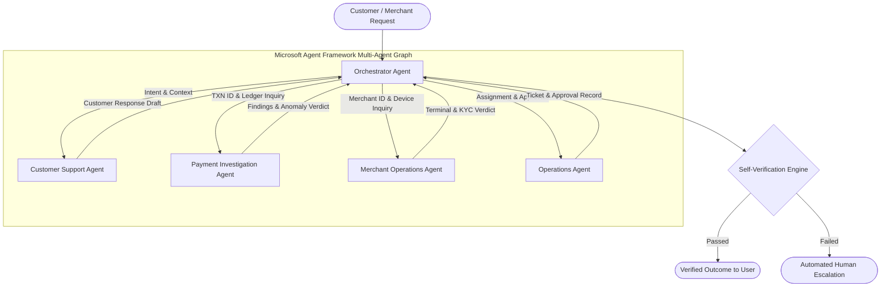

# AI-Native Engineering Specification - System Specification
**Project**: Paytm ResolveAI  
**Domain**: Autonomous Payment Operations & Merchant Support  
**Version**: 1.0.0-PROD  
**Standard**: OpenSpec / AI-Native Enterprise Architecture  

---

## 1. System Vision & Paradigm Shift

Traditional customer support systems rely on static rule engines, decision trees, or naive single-prompt LLM wrappers. These systems fail when handling asynchronous financial transactions because they cannot:
1. Reason across distributed ledger states (Customer UPI $\leftrightarrow$ NPCI Gateway $\leftrightarrow$ Acquirer Bank $\leftrightarrow$ Merchant Settlement).
2. Autonomously plan and delegate sub-investigations to specialist operational roles.
3. Validate their own actions against authoritative transactional databases.
4. Enforce strict safety boundaries against unauthorized financial movement.

**Paytm ResolveAI** is built on **AI-Native Engineering Principles**:
- **State as First-Class Citizen**: Every multi-agent conversation is represented as an immutable state machine with typed context schemas.
- **Deterministic Action Boundaries**: Neural models make observations, classify intents, and propose plans; deterministic code verifies preconditions, queries databases, and enforces policies.
- **Dual-Verification Loops**: No state change (ticket created, follow-up scheduled, refund proposed) is confirmed without an independent backend verification probe.
- **Human-in-the-Loop (HITL) Gateways**: Monetary actions (refunds, debit reversals, ledger adjustments) cannot be executed by LLMs. They generate typed `ApprovalRequest` records in Azure SQL requiring authenticated officer signatures.

---

## 2. Multi-Agent Topology & Core Responsibilities

| Agent Name | System Role | Primary Input | Primary Output | Safety Class |
|---|---|---|---|---|
| **Orchestrator** | Task Decomposition & Graph Controller | User message + Session history | Structured multi-agent plan & synthesis | Policy Gated |
| **Customer Support** | Intent, Sentiment & Ticket Management | Customer context + Complaint text | Customer category, sentiment, drafted response | Read/Write (Non-Financial) |
| **Payment Investigation** | Transaction deep-dive & anomaly checks | Transaction ID / Customer ID / Amount | Gateway status, anomaly diagnosis | **Strict Read-Only** |
| **Merchant Operations** | Merchant profile, Soundbox, EDC, KYC | Merchant ID / Phone / Store name | Device health, settlement lag, sales lead | Read/Write (Non-Financial) |
| **Operations** | Case assignment, SLA, HITL Approvals | Pending action details + Risk level | Assigned employee, approval ticket ID | Strict Approval Gated |

---

## 3. Operational Invariants & Guardrails

1. **Financial Ledger Invariant**: Under no circumstance shall any LLM agent have tool execution access to API endpoints that initiate money transfers, bank debits, or payment credits.
2. **Execution Bounds**:
   - Maximum Agent Graph Iterations: $N \le 8$.
   - Hard Wall-Clock Timeout: $T \le 45\text{ seconds}$.
   - Token Quota Per Interaction: $\le 4,000$ prompt tokens / $\le 1,000$ completion tokens.
3. **Escalation Threshold**: If the confidence score of an investigation drops below $0.75$, or if a transaction remains unresolved after 2 agent attempts, the task is immediately transitioned to `ESCALATED` status and assigned to an operations officer.
4. **Data Isolation Invariant**: Customer and merchant identifiers must remain scoped strictly to the authenticated session context. Cross-customer memory contamination is blocked by session token validation.
