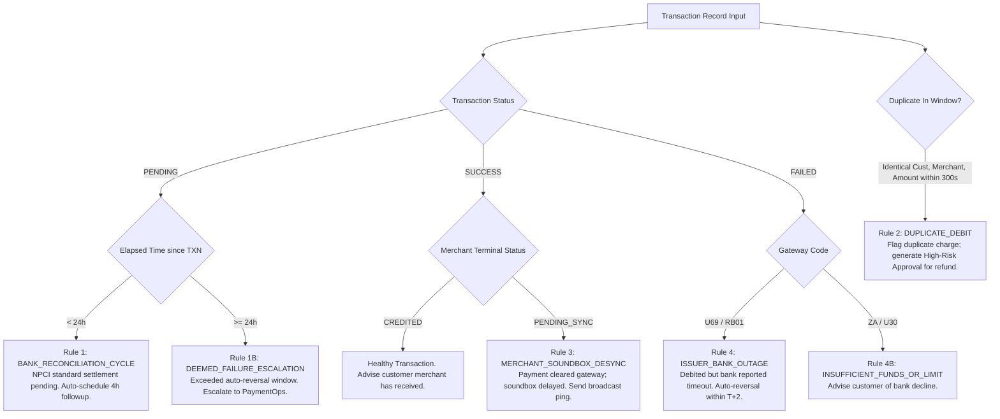

# AI-Native Engineering Specification - Deterministic Anomaly & Opportunity Rules
**Project**: Paytm ResolveAI  
**Domain**: Deterministic Financial Rules & Sales Signal Mining  

---

## 1. Deterministic Payment Anomaly Engine

To guarantee zero hallucinated financial conclusions, all payment diagnoses are computed via deterministic logic rules:

### Formal Rule Specifications

#### Rule 1: `BANK_RECON_PENDING`
- **Condition**: `status == 'PENDING'` AND `(now - timestamp) < 24 hours`
- **Root Cause**: Bank CBS or NPCI switch processing queue.
- **Action**: Explain 24–48 hour NPCI settlement window; create ticket with `sla_deadline = +4h`; schedule automated follow-up.

#### Rule 2: `DUPLICATE_DEBIT`
- **Condition**: Exists $T_1, T_2$ where $T_1.\text{customer} = T_2.\text{customer}$, $T_1.\text{merchant} = T_2.\text{merchant}$, $T_1.\text{amount} = T_2.\text{amount}$, and $|T_1.\text{created} - T_2.\text{created}| \le 300\text{ seconds}$.
- **Root Cause**: Customer double-tapped or app retried on network jitter.
- **Action**: Mark second transaction `DUPLICATE_SUSPECT`; dispatch `ApprovalRequest` (`action_type='TRIGGER_REFUND'`, `risk_level='HIGH'`) to Payment Operations.

#### Rule 3: `MERCHANT_TERMINAL_DESYNC`
- **Condition**: `gateway_status == 'SUCCESS'` AND `merchant_terminal_status == 'PENDING'`.
- **Root Cause**: Merchant Soundbox or EDC POS lost GSM/Wi-Fi connection during settlement push.
- **Action**: Provide Soundbox manual sync instruction (Press volume up + power for 3 seconds); advise customer that funds are safely cleared.

---

## 2. Merchant Sales Opportunity Detection Rules

During merchant inquiries, the Merchant Operations Agent scans transaction volume and hardware profiles to surface high-conversion business opportunities:

| Opportunity Code | Trigger Condition | Recommended Operational Pitch |
|---|---|---|
| `SOUNDBOX_UPGRADE` | Merchant transaction count $> 50/\text{day}$ AND `device_generation == 'SOUNDBOX_V1'` | Upgrade to **Paytm Soundbox 4.0** with instant vernacular voice alerts and battery backup. |
| `LOAN_ELIGIBILITY` | Merchant 90-day UPI gross volume $> \text{₹}1,50,000$ AND KYC status is `VERIFIED` | Eligible for **Paytm Merchant Cash Advance** (Pre-approved working capital loan up to ₹2,00,000). |
| `EDC_POS_CONVERSION` | Merchant operates in 'Dining' or 'Retail' category AND avg ticket size $> \text{₹}1,000$ | Deploy **Paytm Card Machine (EDC POS)** to accept Credit/Debit cards with instant EMI. |
